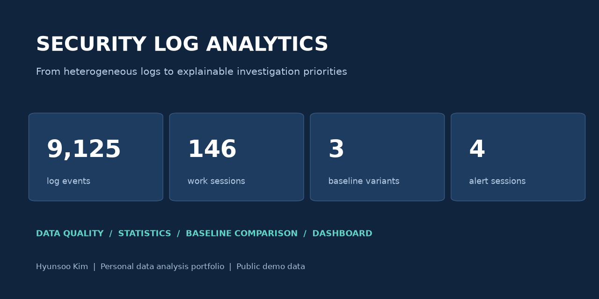
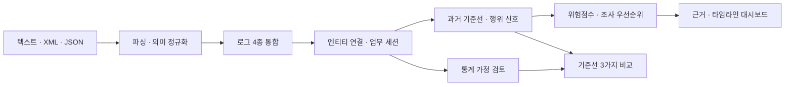
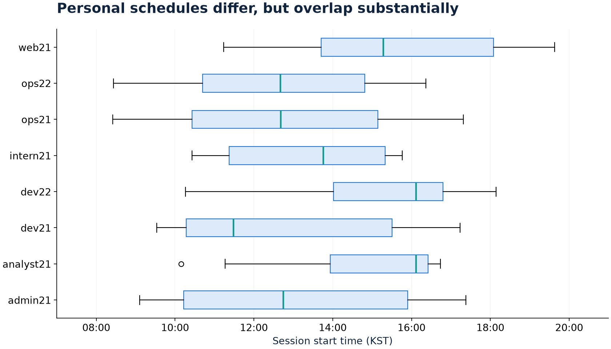
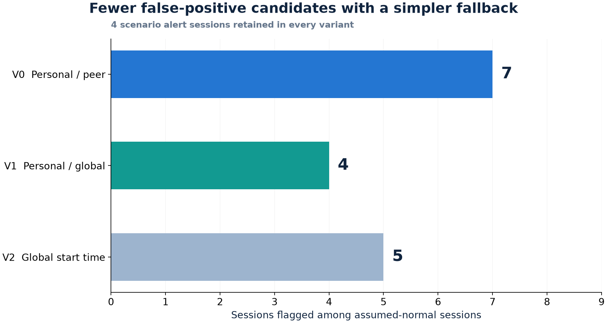
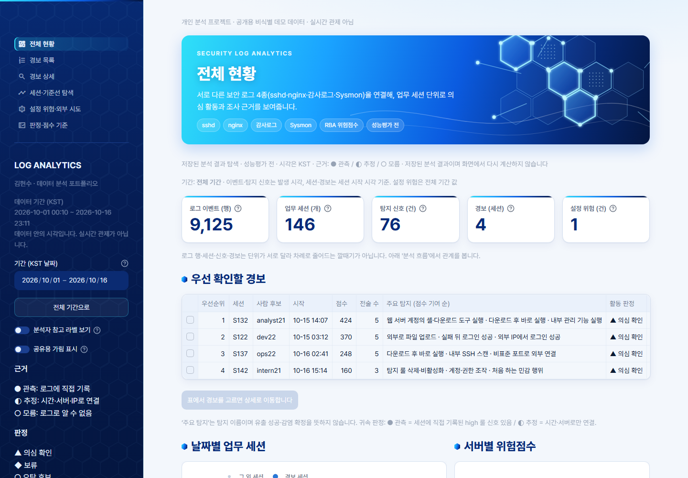
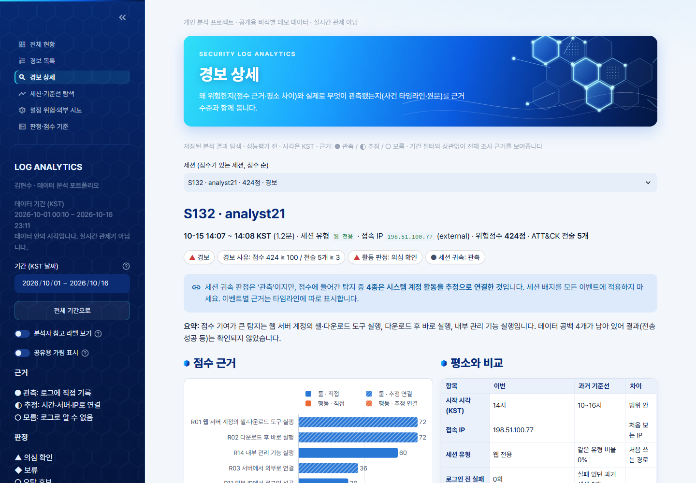

# 보안 로그 교차 분석으로 조사 우선순위 설계

**김현수 · 데이터 분석 프로젝트**

형식과 식별자가 다른 보안 로그를 분석 가능한 업무 세션으로 연결하고, 통계 검정과 기준선 비교를 통해 설명 가능한 조사 우선순위를 설계했습니다.



[핵심 분석](docs/05_기준선비교.md) · [데이터 품질](docs/02_데이터품질.md) · [재현 방법](docs/08_실행가이드.md) · [검증 결과](results/validation_summary.json)

## 프로젝트 요약

| 항목 | 내용 |
|---|---|
| 작성자·형태 | 김현수 · 개인 분석 및 구현 포트폴리오 |
| 데이터 출처 | 기업연계 프로젝트에서 테이렌이 제공한 보안 로그 4종 |
| 포트폴리오 공개 버전 | 2026-10-09 작성. 데이터 내부 시각과 작업 일자는 별개 |
| 관측 기간 | 데이터 내부 UTC 2026-09-30~2026-10-16. 실시간 수집 아님 |
| 도구 | Python, Snowflake SQL, SciPy, pandas, matplotlib, Streamlit, Plotly |
| 범위 | 파싱·정규화, 엔티티 연결·세션화, 기준선·지표 설계, 통계 검정, 대안 비교, 조사 화면 구성 |
| 공개 데이터 | 계정·IP·호스트·이메일·고객 식별값 등을 치환한 비식별 데모 입력 |

제공 로그는 합성 데이터일 가능성이 있습니다. 실제 운영 로그나 운영 환경의 성능으로 확정해 소개하지 않습니다.

## 해결하려는 문제

SSH 접속 로그, 웹 요청 로그, 서버 프로세스 XML, 콘솔 감사 JSON은 형식뿐 아니라 계정과 IP의 의미도 다릅니다. 로그별로 이상 신호만 나열하면 같은 활동을 중복해서 보고, 서버 활동을 특정 사용자에게 잘못 연결할 수 있습니다.

**분석 질문:** 서로 다른 로그를 어떤 근거로 연결하고, 평소 활동과 비교해 무엇부터 조사하도록 제안할 수 있을까?

## 핵심 결과

| 결과 | 확인한 내용 |
|---|---|
| 로그 4종, **9,125행** 통합 | 시간·행위를 통일하고 원문 복원 및 행 수 보존 검증 |
| **146개 업무 세션**, 탐지 신호 76건, 경보 세션 4개 | 세션별 점수 근거와 관측·추정 연결을 구분 |
| 기준선 대안에서 오탐 후보 **7→4개** | 시나리오 경보 4개 유지. 결과를 본 뒤 수행한 탐색적 비교 |

이벤트 행·세션·신호·경보는 단위가 다릅니다. 이 숫자들의 차이를 업무량 감소율이나 탐지 성능으로 해석하지 않습니다.

## 분석 과정



### 1. 같은 이름을 곧바로 같은 사람으로 연결하지 않기

Linux 계정과 콘솔 계정은 식별 체계가 다릅니다. 이름 조인 대신 같은 로그 안의 연결 키, 접속 IP·시간, 프로세스 키를 활용하고 추정 연결에는 근거를 남겼습니다. Sysmon의 `src`도 접속자 IP가 아니라 서버 IP이므로 의미를 분리했습니다.

[데이터 품질과 처리 기준](docs/02_데이터품질.md) · [엔티티 연결 코드](scripts/06_link_classify.py)

### 2. 통계적으로 차이가 있어도 개인 기준선이 반드시 우수할까?

시나리오 4개를 제외한 142개 세션에서 개인별 시작 시각 분포는 차이가 있었지만(Kruskal–Wallis, Holm 보정 p≈0.0014), 개인별 시간대가 크게 겹쳤고 28쌍 사후 비교에서 보정 후 유의한 쌍은 없었습니다. 이 결과를 개인 기준선의 우수성으로 단정하지 않고 대안 비교로 이어갔습니다.



*공개용 계정 별칭, KST. 같은 사람의 반복 관측과 작은 표본을 포함한 탐색적 분석입니다.*

[통계 결과와 해석](docs/04_통계분석.md) · [통계 코드](scripts/12_stat_tests.py)

### 3. 개인 기록이 부족할 때 동료 대신 전체 과거를 쓰면?

| 비교안 | 행위 신호 | 오탐 후보 세션 | 경보 세션 |
|---|---:|---:|---:|
| V0: 본인 과거 부족 시 동료 기준 | 21 | 7 | 4 |
| V1: 본인 과거 부족 시 전체 기준 | 18 | **4** | 4 |
| V2: 시작 시각만 전체 기준 | 19 | 5 | 4 |



*비교 대상 126개 세션과 점수·경보 규칙을 고정했습니다. 시나리오 외 세션을 정상으로 가정했으며 임계값은 같은 희귀도 규칙으로 방식별 재계산했습니다.*

**판단:** 이 데이터에서는 더 단순한 V1이 오탐 후보를 3개 줄이고 시나리오 경보를 유지했습니다. V1은 후속 적용 제안이며 기본 파이프라인의 기준선은 V0입니다. 다른 기간·독립 라벨에서의 검증이 필요합니다.

[비교 설계·결과·한계](docs/05_기준선비교.md) · [비교 코드](scripts/13_compare_baselines.py) · [결과 CSV](results/baseline_comparison.csv)

## 분석 결과를 조사 화면으로 연결



경보의 점수 구성, 평소 활동과의 차이, 시간순 이벤트, 사용자 귀속의 추정 여부, 추가 수집이 필요한 로그를 함께 확인하도록 구성했습니다. 조사 시간 단축 효과는 측정하지 않았습니다.



**대표 사례 S137:** 서버의 다운로드·내부 SSH 스캔·외부 연결은 관측 사실입니다. 해당 활동을 로그인 사용자에게 귀속하는 연결은 시간·서버를 이용한 추정입니다. 의심 활동의 관측과 공격 성공·행위자 확정은 구분합니다.

[사례와 데이터 공백](docs/06_대표사례.md) · [대시보드 코드](dashboard_v2/app.py)

## 직접 수행한 작업과 판단

| 작업 | 주요 의사결정·근거 |
|---|---|
| SQL·Python 파싱 및 정규화 | 로그 형식별 파싱, UTC 통일, 원문·미사용 필드 보존과 복원 검증 |
| 분석 단위 설계 | 이벤트·업무 세션·시스템 배경 활동·외부 시도를 분리 |
| 기준선·지표 설계 | 각 세션 시작 전에 완료된 기록만 이력으로 사용, 기록 부족 상태를 분리 |
| 통계 검정·비교 실험 | p값만으로 설계 우수성을 판단하지 않고 실제 신호 변화를 비교 |
| 조사 우선순위·시각화 | 점수 근거, 관측·추정·모름, 데이터 공백을 화면과 문서에 표시 |

데이터 제공·기업 멘토링은 분석 입력과 배경이며 개인 프로젝트의 데이터 출처로 명시합니다. [범위 설명](docs/01_프로젝트와역할.md)

## 재현하기

Python **3.14**에서 검증한 버전을 고정했습니다. 저장소 최상위에서 실행합니다.

```bash
python -m venv .venv
# Windows: .venv/Scripts/Activate.ps1
# macOS/Linux: source .venv/bin/activate
python -m pip install -r requirements.txt
python scripts/run_pipeline.py
python -m streamlit run dashboard_v2/app.py
```

`run_pipeline.py`는 공개 데모 입력에서 파싱부터 조사·통계·기준선 비교·검증·차트 생성까지 수행합니다. 생성 CSV는 `data/01_raw`~`data/13_baseline_variants`에 저장되며 Git에서 제외합니다. 재실행 시 생성 결과를 갱신합니다.

[자세한 실행 안내](docs/08_실행가이드.md) · [데이터 안내](data/README.md) · [전체 실행 코드](scripts/run_pipeline.py) · [SQL 안내](sql/snow/README.md)

## 검증과 한계

- 행 수 보존, 이벤트·세션 키 무결성, 과거 이력 선택, 위험점수 합계, 기준선 비교 결과를 자동 검증합니다.
- Streamlit 페이지·필터·경보·집계값을 결과 CSV와 대조합니다.
- 독립된 정답 라벨 기반의 Precision·Recall·실제 유출 성공 판정은 수행하지 않았습니다.
- 합성 가능성이 있는 소규모 데이터, 알려진 시나리오, 세션 정의의 영향, 반복 관측을 고려해야 합니다.
- 시간 분리 평가, 독립적 정상·이상 라벨, 세션 연결 신뢰도, 저속 외부 시도 탐지를 후속 과제로 남겼습니다.

[검증 요약](results/validation_summary.json) · [수치 근거](results/metrics.json) · [한계와 후속 계획](docs/07_한계와개선.md)

## 문서와 코드

| 목적 | 위치 |
|---|---|
| 문제·개인 작업 범위 | [프로젝트와 역할](docs/01_프로젝트와역할.md) |
| 데이터 정제·검증 | [데이터 품질](docs/02_데이터품질.md) |
| 세션·기준선 설계 | [세션과 기준선](docs/03_세션과기준선.md) |
| 가정·통계 해석 | [통계 분석](docs/04_통계분석.md) |
| 개선 실험 | [기준선 비교](docs/05_기준선비교.md) |
| 결과 활용 | [대표 사례](docs/06_대표사례.md) |
| 공개용 데이터·재현 | [실행 가이드](docs/08_실행가이드.md) |

작성자: **김현수** · [GitHub](https://github.com/univ237138-spec)
