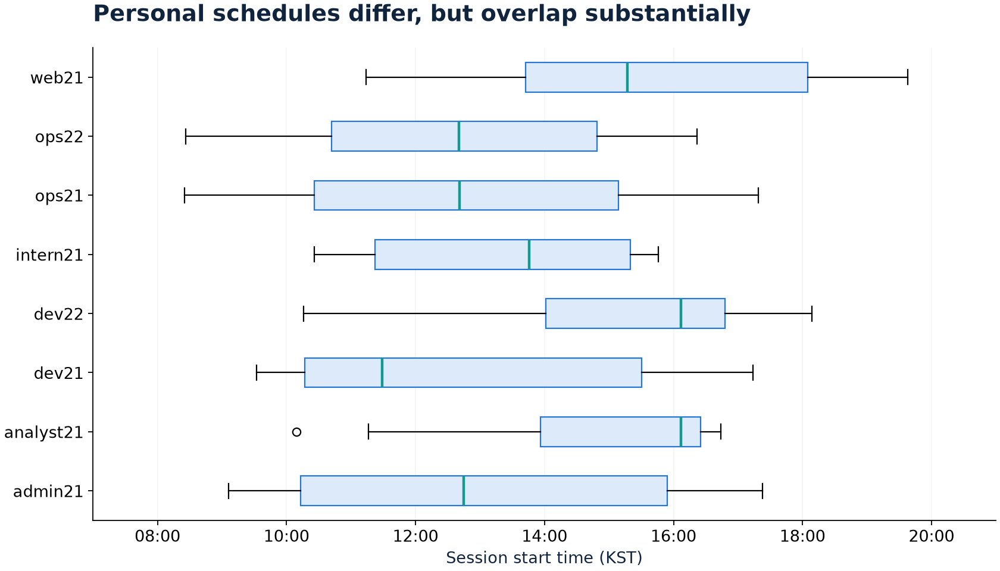

# 통계 가정 검토

[프로젝트 소개](../README.md) · [결과 CSV](../results/statistical_tests.csv) · [코드](../scripts/12_stat_tests.py)

시나리오 참고 세션 S122·S132·S137·S142를 제외한 142개 세션을 주 표본으로 사용한다. 해당 구분은 초기 분석기획의 계정·시간 정보로 지정한 참고 표본이며 독립적인 운영 정답 라벨이 아니다. 전체 146개와 세션 구성 규칙 변경 전 표본도 민감도로 확인한다.

## 가정 1: 정상 활동은 웹·서버 경로를 함께 사용하는가?

정확 이항검정에서 H0는 동시 사용 비율 p≤0.90이다. 주 표본의 비율은 142/142, 95% 신뢰구간은 약 0.979~1.000, 두 주 검정의 Holm 보정 p값은 약 6.36×10⁻⁷이다.

이 결과에는 SSH와 웹 이벤트를 연결한 **세션 정의의 영향**이 있다. 구성 규칙 변경 전에도 높은 동시 사용 비율이 관측되지만, 이를 탐지 정확도나 독립적인 정상 행위 검증으로 부르지 않는다.

## 가정 2: 개인별 시작 시각 차이는 개인 기준선을 정당화하는가?

Kruskal–Wallis 결과 H≈23.502, df=7, Holm 보정 p≈0.001393이다. 개인별 시작 시각 분포에 차이는 있지만 같은 업무시간 구간에서 크게 겹친다. 28쌍 Mann–Whitney 사후 검정은 Holm 보정 후 유의한 쌍이 0개다. 이것이 모든 개인의 분포가 같다는 증거는 아니다.

코드의 효과 크기 출력은 H/(n−1)≈0.167이다. 사용한 정의를 명시하며 인과적 설명력이나 “17%의 원인이 개인”이라는 의미로 해석하지 않는다. 같은 사람의 반복 세션에 대한 의존성도 별도 모델링하지 않았다.

**분석 판단:** 개인별 통계적 차이를 설계의 우수성과 동일시하지 않고, 동료·전체 기준선을 실제로 비교한다. [기준선 비교](05_기준선비교.md)

## 해석 범위

데이터를 본 뒤 설정한 탐색적 가정이며 시나리오를 알고 분석했다. 작은 표본과 합성 가능성을 고려해야 한다. 독립 기간 평가·사람 단위 재표본화·반복 관측을 고려한 검정을 후속 검증으로 둔다.
