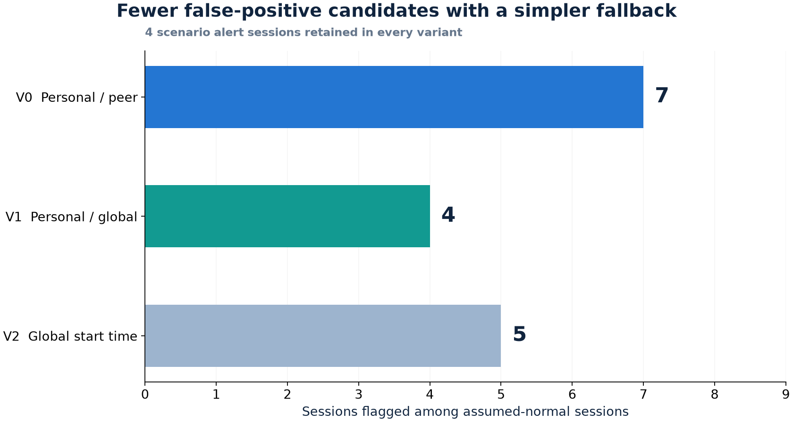

# 기준선 비교: 복잡성이 실제 이득을 만드는가?

[프로젝트 소개](../README.md) · [실험 코드](../scripts/13_compare_baselines.py) · [결과 CSV](../results/baseline_comparison.csv)

## 계기

작은 시간 차이와 활동량 이탈이 비경보 세션 7개에서 행위 신호를 만들었다. 일부는 본인 과거가 부족해 동료 기준선을 쓴 세션이었다. 통계 검정에서 업무시간 분포의 겹침이 관측되어 기준선 대안을 비교했다.

## 비교 조건

| 항목 | 통제·변경 내용 |
|---|---|
| 대상 | 기존 person·peer 수준의 126개 세션을 동일하게 비교 |
| V0 | 본인 기록 부족 시 동료 기준선 |
| V1 | 본인 기록 부족 시 전체 과거 기준선 |
| V2 | V0를 유지하되 시작 시각만 전체 과거 기준선 |
| 임계값 | 동일한 5% 희귀도 규칙으로 각 방식의 임계값 재계산 |
| 고정 | 룰 신호, 시스템 패턴 신호, 위험점수 가중치, 경보 기준 |
| 정상 가정 | 참고 시나리오 4개를 제외한 나머지 세션을 정상으로 가정 |
| 재현 | V0의 신호·점수·경보를 기본 파이프라인 결과와 대조 |

## 결과

| 결과 | V0 | V1 | V2 |
|---|---:|---:|---:|
| 시작 시각 임계값 | 2시간 | 2시간 | 1시간 |
| 행위 신호 | 21 | 18 | 19 |
| 오탐 후보 세션 | 7 | **4** | 5 |
| 그중 기존 peer 세션 | 3 | **0** | 2 |
| 경보 세션 | 4 | 4 | 4 |
| 비시나리오 세션 최고 점수 | 20 | 20 | 20 |

시나리오 세션 점수는 모든 방식에서 S122=370, S132=424, S137=248, S142=160으로 유지된다. V1은 동료 기준선에 의해 걸린 후보 3개를 제거했다.

V2는 전체 과거 범위가 넓어지는 효과와 임계값이 2시간에서 1시간으로 내려가는 효과가 함께 발생했다. 일부 기존 신호가 사라지지만 데이터 초반의 좁은 과거 범위에서 새 신호가 생겨 V1보다 후보가 많았다.

## 판단과 제안

이 데이터에서는 V1이 더 단순하면서 후보를 줄였다. 비교는 본 파이프라인을 변경하지 않은 별도 실험이며 **V1 적용은 후속 제안**이다. 경보 수준에서는 3개 방식의 결과가 같고, 신호 수준의 차이가 관측되었다.

## 한계

- 후보 2~3개 차이의 작은 비교이며 결과를 본 뒤 설계했다.
- 비시나리오 세션을 정상으로 가정했다. 독립 정답으로 확인된 오탐 수가 아니다.
- 시나리오 경보 유지가 운영 탐지율 100%를 뜻하지 않는다.
- 기준선별 임계값 재계산을 포함하므로 기준선만의 순수한 인과 효과로 해석하지 않는다.
- 별도 기간·독립 라벨과 임계값 고정/재교정 조건을 나눠 확인해야 한다.
