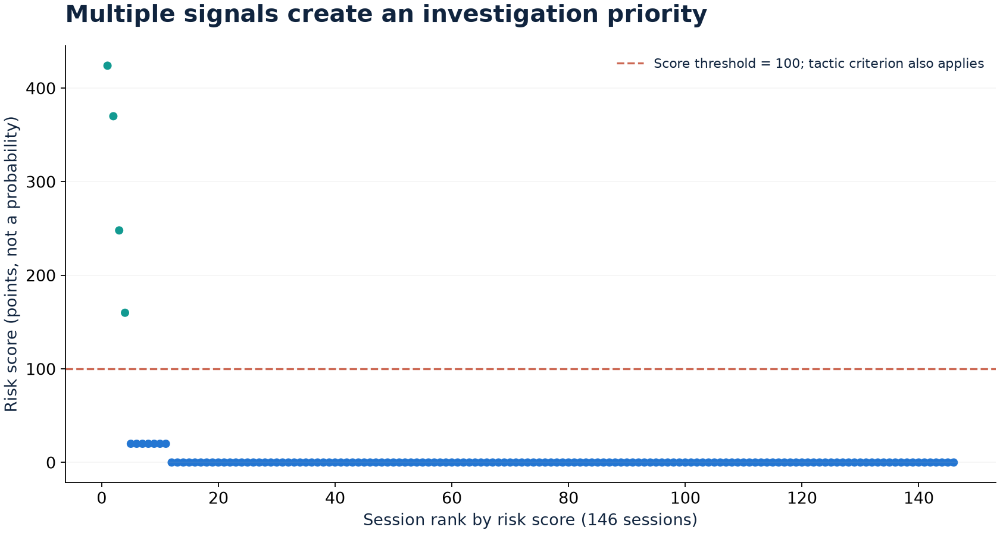

# 조사 우선순위와 대표 사례

[프로젝트 소개](../README.md) · [탐지](../scripts/09_detect.py) · [점수](../scripts/10_risk.py) · [조사](../scripts/11_investigate.py)

## 점수의 의미

룰 신호의 기본 점수는 중요도별 60/30/10, 행위 신호는 20이다. 신호마다 자산 중요도와 연결 신뢰도를 곱하고, 세션 안의 탐지 종류별 최대 점수를 합산해 반복 신호의 중복 누적을 막는다. 경보는 점수 100 이상 또는 전술 3개 이상이다. 확률·공격 성공 확정·사용자 과실 판정으로 해석하지 않는다.

가중치 27개 조합의 기존 민감도 확인에서 같은 4개 경보와 같은 상위 10개 세션이 유지되었다. 이는 작은 데이터에서의 점수 안정성 확인이며 독립 성능 검증이 아니다.

## 사례 S137: 활동 관측과 사용자 귀속을 구분

| 구분 | 내용 |
|---|---|
| 관측 | compute-01의 root 계정이 스크립트 다운로드·실행, 내부 SSH 스캔, 문서용 외부 주소의 4444 포트 연결 |
| 세션 | ops22의 SSH 로그인 이후 비슷한 시각에 같은 서버 활동이 관측됨 |
| 점수 | 248점, 경보 기준 충족 |
| 추정 | 시스템 계정 활동을 ops22 세션에 연결한 것은 시간·서버 기반 귀속 추정 |
| 확인 불가 | 전송 내용·성공 여부, 실제 로그인 사용자와 root 프로세스의 확정 연결 |

활동 자체가 기록됐다는 사실과 특정 사람이 수행했다는 귀속을 구분한다. 이 데이터에서는 동시간의 다른 사용자 후보가 없지만 확정 근거가 되지는 않는다.

## 경보에 붙인 조사 맥락

평소 시간대·IP·경로와의 차이, 인증 실패 후 성공, 주요 신호와 점수 구성, 시스템 활동 연결, 생성 파일·외부 목적지, 설정 변경, 동시간 다른 세션, 필요한 추가 로그를 경보 맥락으로 만든다. `alert_context.csv`에 결과를 저장한다.

## 수집 개선 과제

| 질문 | 추가로 필요한 자료 |
|---|---|
| bastion에서 작업 서버로 누가 넘어갔는가 | 작업 서버의 sshd 로그 |
| root·서비스 계정 활동을 누가 시작했는가 | auditd의 auid, sudo 로그 |
| 웹 요청이 프로세스로 어떻게 이어졌는가 | 애플리케이션 로그와 공통 요청 ID |
| 외부 전송의 내용·크기·성공 여부는 무엇인가 | 방화벽·프록시·NetFlow·DNS 로그 |

대시보드는 이러한 조사 맥락을 제공한다. 실제 분석가의 조사 시간이나 운영 효과는 측정하지 않았다.
